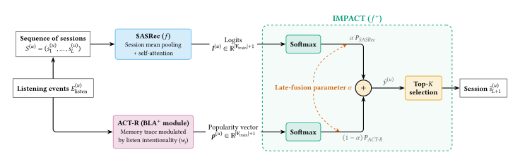

# IMPACT

**I**ntention-**M**odulated **P**ersonalized **ACT**-R &mdash; a hybrid sequential/cognitive-memory recommender system for music that beats SASRec (SOTA) by 114% NDCG@10 on the 4.8B-interaction Yambda-5B dataset. The full pipeline &mdash; download through training &mdash; runs within 16GB of RAM with no GPU and no OOM; the reported results were trained on GPU via Kaggle for speed though.

Built for master's thesis at Wrocław University of Science and Technology.

  

